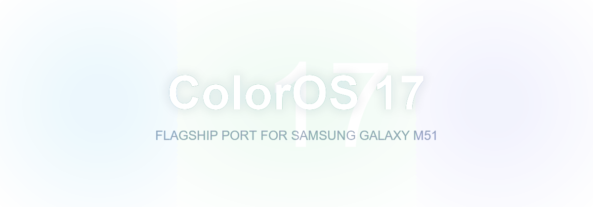

<h1 align="center">
  
</h1>

  
  
  
  

ColorOS <i>(/ˈkʌl.ər.oʊ.ɛs/)</i> is a custom firmware port for Samsung Galaxy SM7150 devices.

  <a href="https://github.com/Arnav3078/ColorOS17-SM7150/discussions">🚀 Discussions</a>
  •
  <a href="https://t.me/Arnav3078">💬 Telegram</a>

# What is ColorOS 17 for M51?
ColorOS 17 is a work-in-progress custom firmware port for Samsung Galaxy devices, designed to provide a refined, optimized and fluid ColorOS experience. It is based on the latest iteration of OPPO's flagship software (Qualcomm Snapdragon 8 Gen 3 base) and it integrates numerous improvements, optimizations and exclusive features.

The build system automatically runs via GitHub Actions, building the required tools, downloading and extracting firmware components, applying the required device-specific patches and generating a flashable zip for the target device.

The goal is to deliver a fast, smooth and modern UX while preserving all high-end parallel processing animations and live Gaussian blurs, while debloating useless background logging daemons and telemetry for power users.

Any form of contribution, suggestions, bug report or feature request for the project will be welcome.

# Features
### Core features:
- Based on the latest stable Snapdragon 8 Gen 3 flagship ColorOS firmware
- EROFS powered
- ColorOS flagship wallpapers and sounds included
- Aqua Dynamics and Fluid Cloud support
- High end animations
- Native/live blur support
- AOD clock transition support
- Adaptive color tone support
- Extra brightness support
- Picture remaster support
- Object, shadow and reflection eraser support
- Multi user support
- Flexible floating windows and split-screen multitasking
- Camera privacy toggle support
- Debloated from useless system services, logging daemons, and additional carrier apps
- Dual Messenger available for all apps
- Custom font support
- Outdoor mode support
- Samsung Galaxy M51 center punch hole display cutout support
- Physical side-mounted fingerprint sensor support
- Massive 7000mAh battery profile and charging curve
- Dolby Atmos audio integration

### ColorOS-exclusive features:
- Parallel Processing animation engine (zero-jank gesture fluidity)
- Native/live blur toggle
- SurfaceFlinger buffer scheduling and HWUI render thread priority
- Tuned Dalvik VM heap for Snapdragon 730G (6GB/8GB RAM)
- Key attestation spoof options*
- Play Integrity Fix integrated
- Ability to hide installed apps
- Ability to hide developer options
- Games FPS unlock toggle
- Bypassed IMS VoLTE retry loops to prevent background modem battery drain**

\* Requires a valid keybox  
\** VoLTE is not available due to Samsung's proprietary closed-source RIL implementation on cross-OEM ports

# Building via GitHub Actions
The entire build process runs automatically via GitHub Actions:
1. Navigate to the [Actions](https://github.com/Arnav3078/ColorOS17-SM7150/actions) tab.
2. Select **Build ColorOS 17 for Galaxy M51**.
3. Click **Run workflow** and provide your donor firmware URL.
4. Download the flashable ZIP directly from GitHub Releases or the GoFile mirror.

# Licensing
This project is licensed under the terms of the [GNU General Public License v3.0](LICENSE). External dependencies might be distributed under a different license, such as:
- [android-tools](https://github.com/nmeum/android-tools), licensed under the [Apache License 2.0](https://github.com/nmeum/android-tools/blob/master/LICENSE)
- [apktool](https://github.com/iBotPeaches/Apktool), licensed under the [Apache License 2.0](https://github.com/iBotPeaches/Apktool/blob/master/LICENSE.md)
- [erofs-utils](https://github.com/sekaiacg/erofs-utils/), dual license ([GPL-2.0](https://github.com/sekaiacg/erofs-utils/blob/dev/LICENSES/GPL-2.0), [Apache-2.0](https://github.com/sekaiacg/erofs-utils/blob/dev/LICENSES/Apache-2.0))
- [lpmake](https://android.googlesource.com/platform/system/extras/+/master/partition_tools/), licensed under the [Apache License 2.0](https://android.googlesource.com/platform/system/extras/+/master/LICENSE)
- [payload-dumper-go](https://github.com/ssut/payload-dumper-go), licensed under the [Apache License 2.0](https://github.com/ssut/payload-dumper-go/blob/master/LICENSE)

# Contributors

# Credits
A special thanks goes to the following for their invaluable contributions in no particular order:
- **OPPO & OnePlus** for ColorOS and OxygenOS
- **Samsung** for Galaxy M51 hardware foundation
- **[toraidl](https://github.com/toraidl)** for ColorOS porting research and tools
- **[Mehedi H Joy](https://github.com/mehedihjoy0)** for the base for m51
- **[Pascua](https://github.com/pascua28)** for patches made for a71
- **[UN1CA Team](https://github.com/salvogiangri/UN1CA)** for the project structure inspiration
- *All project contributors, testers and users ❤️*
